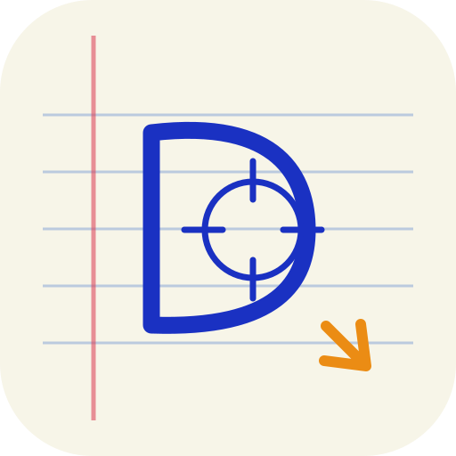
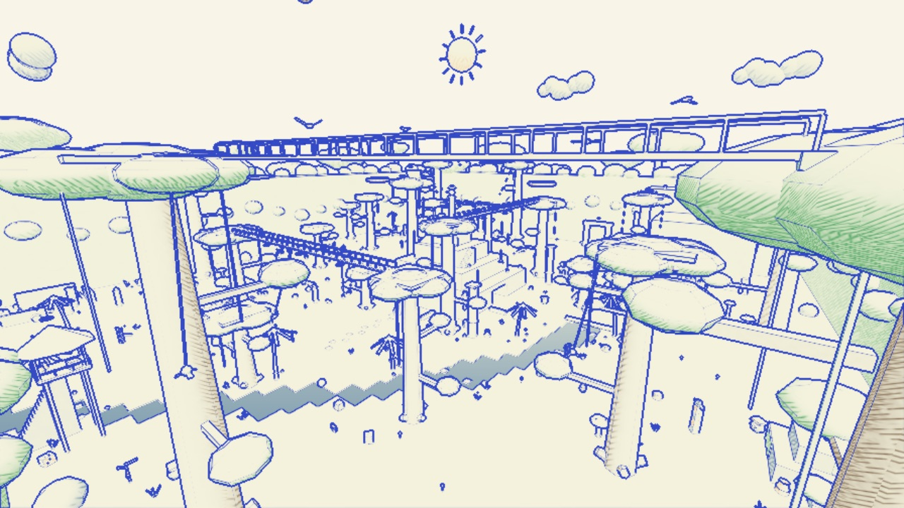
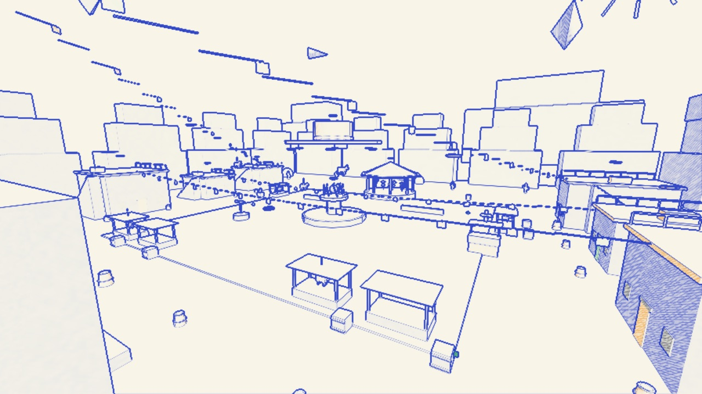
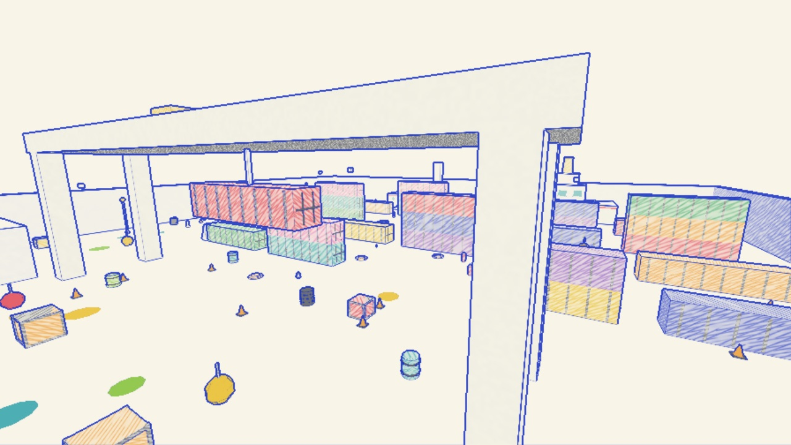
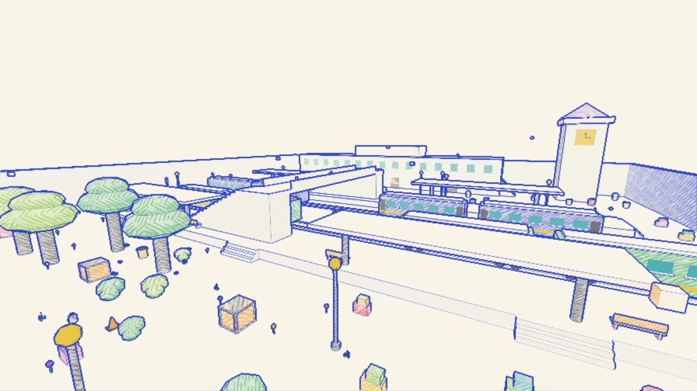
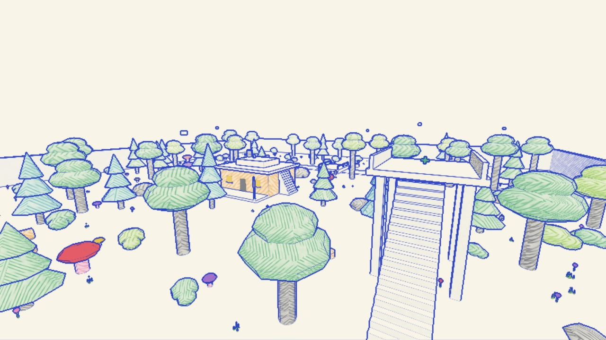
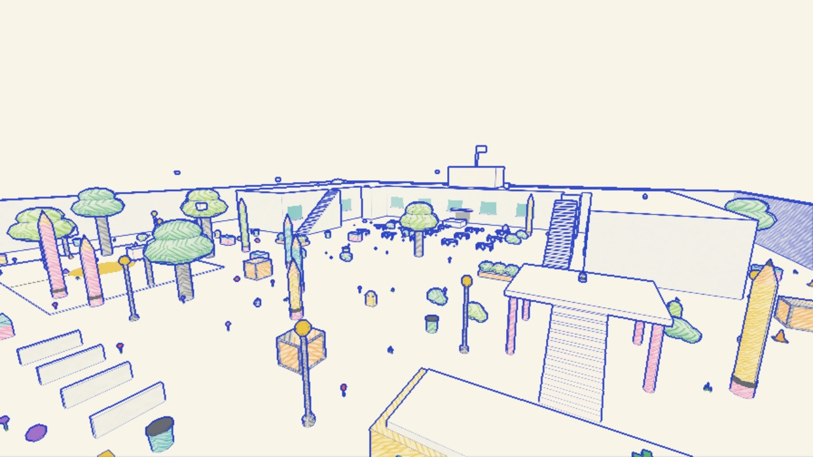

<div align="center">
  
  <h1>doodleshooter-port</h1>
  <p>An unofficial native port of <a href="https://doodleshooter.vercel.app/">Doodle District</a> for Mobile and Desktop.</p>
</div>

The name combines **port** and **portable**. *Reproduce the original game first; create new maps afterward.*

The project provides **offline survival**, **offline free-for-all with bots**, **built-in LAN hosting**, and an **experimental online lobby mode**. **It is not yet a complete clone**: reference comparison, complete multiplayer validation, and device verification remain unfinished. See [docs/PARITY.md](docs/PARITY.md) for the full status.

All port UI and project documentation are in English. Original-game attribution appears in the game and in [CREDITS.md](CREDITS.md). The historical upstream source snapshot is preserved unchanged for provenance and contains its own localized strings; it is *not* shipped in the native application.

## 📑 Contents

- [🗺️ Maps](#-maps)
- [🚀 Run](#-run)
- [🕹️ Controls](#-controls)
- [🤖 Android](#-android)
- [🎮 Offline play](#-offline-play)
- [📡 Local network (LAN)](#-local-network-lan)
- [🙌 Credits](#-credits)
- [🌐 Experimental online play](#-experimental-online-play)
- [🍎 iOS](#-ios)
- [💻 Desktop (Windows, Linux, macOS)](#-desktop-windows-linux-macos)
- [✅ Verification](#-verification)
- [🛠️ Tech stack](#-tech-stack)
- [📁 Reference and layout](#-reference-and-layout)

## 🗺️ Maps

**Doodle District**, **Doodle Jungle**, and **Doodle Mexico** come from the original game (*Jungle* comes from the deployed web version archived separately on November 19, 2026). The other seven are **port additions** and are *not* part of the original. All are shown in the port's coloured-pencil shading; the original hatching is available in **Settings**.

| | | |
| --- | --- | --- |
|  **Doodle District** *(original)* |  **Doodle Jungle** *(original)* |  **Doodle Mexico** *(original)* |
|  **Doodle Castle** *(port)* |  **Doodle Harbor** *(port)* |  **Doodle Pyramid** *(port)* |
|  **Doodle Station** *(port)* |  **Doodle Forest** *(port)* |  **Doodle School** *(port)* |
|  **Doodle Base** *(port)* | | |

Regenerate screenshots with `make screenshots` (*desktop renders, converted with macOS `sips`*).

## 🚀 Run

Install standard **Godot 4.6.3**. Open `native/project.godot` and press **Run**, or use the `Makefile` from the repository root:

```sh
make run
```

To display touch controls on desktop:

```sh
make touch
```

- **Offline** and **LAN** modes work out of the box with no extra server; **Online** mode requires the separate lobby server described below.
- Run `make help` for all targets. Override executables on the command line with `GODOT_BIN`, `PYTHON`, `ADB`, `NODE`, or `NPM`.

## 🕹️ Controls

### ⌨️ Mouse + keyboard & 🎮 Controller

| Action | Mouse + Keyboard | PlayStation / Xbox Controller |
| --- | --- | --- |
| Move | `W` `A` `S` `D` | Left Stick |
| Look | Mouse | Right Stick |
| Sprint | `Shift` | `L3` / `LS` |
| Fire / Slash | `LMB` | `R2` / `RT` |
| Aim / Block | `RMB` | `L2` / `LT` |
| Charged katana execution *(survival)* | `LMB` + `RMB` | `L2` + `R2` / `LT` + `RT` |
| Jump / Wall jump / Double jump | `Space` | `×` / `A` |
| Slide *(ground)* / Air dash *(air)* | `C` | `○` / `B` |
| Grapple *(tap swing, hold reel, press again to release)* | `Q` (`Space` to launch) | `L1` / `LB` (`×` / `A` to launch) |
| Quick katana slash | `F` | `R1` / `RB` |
| Reload | `R` | `□` / `X` |
| Switch weapons | `1`–`7` / Mouse Wheel | `△` / `Y` *(next weapon)* |
| Grenade *(hold to throw further)* | `G` | `R3` / `RS` |
| Smoke grenade *(port)* | `H` | — |
| Scoreboard *(bot / network matches)* | `Tab` | — |
| Pause | `Esc` | `Options` / `Menu` |

### 📱 Touch & gyroscope

Touch controls appear automatically on mobile (*menus use mouse emulation; gameplay uses dedicated multitouch input*):

- **Movement & sprint**: push the left joystick fully forward to sprint; drag up to the `RUN` marker to auto-run with your thumb lifted.
- **Camera**: drag anywhere outside the joystick to turn the camera — *including while holding fire*.
- **Right-thumb cluster**: fire, jump, `SLIDE` / `DASH` (*slides on the ground, dashes in the air*), aim (*tap to latch*), grapple, quick slash, and grenade. Arena modes also add a **scoreboard** button.
- **Weapons & reload**: empty magazines reload automatically; tap the active weapon chip to reload early, or tap another chip to switch weapons.
- **Custom layout**: open **Controls & settings → Customize touch layout** to drag, resize, and adjust opacity for every button (*saved locally on the device*).
- **Touch & aiming options**: configure look/aim sensitivity, inverted vertical look, **gyroscope aiming** (*off*, *while aiming*, or *always*), auto-fire on target, hold-to-aim, a second left-side fire button, a dedicated reload button, and a fixed joystick.

## 🤖 Android

- **Development APK**: `builds/android/doodleshooter-port-debug.apk`
- **Application ID**: `com.doodleshooter.port`
- **ABIs & signing**: `ARM64` and `x86_64` binaries, debug signing key (*not published to Google Play*).
- **Status**: APK signature and bundled resources were verified on November 10, 2026; *physical-device play remains unverified*.

To rebuild, install the **Godot 4.6.3** export templates and configure **Java 17**, the **Android SDK**, and a debug keystore in the editor settings:

```sh
make android
```

- `make build` also exports the debug APK.
- `make install-android` installs that APK on an `adb`-connected device.
- `make android-release` exports a separate release APK after release signing is configured.
- `AAB` exports require a Gradle build.

## 🎮 Offline play

> **Port additions** *(not in the original game)*: seven extra maps with animated preview cards, the **SMG** and **bazooka**, **smoke grenades** (`H`) that blur anyone inside the cloud, a **woozy low-health view** (*toggleable in Settings*), **Easy / Normal / Hard** and wave-size choices for survival, a **graphics detail** setting, a **coloured-pencil shading** style (**Settings → Shading** switches back to the original hatching), and an **FPS counter**. *The revolver comes from the original source.*

Choose **Play offline** from the main menu:

- 🛡️ **Survival**: fight growing enemy waves and bosses, with saved checkpoints.
- 🤖 **Free for all with bots**: choose `1–9` bots and **Easy**, **Normal**, or **Hard** difficulty. Bots fight you and each other. First to **20 kills** wins; otherwise the highest score wins after **10 minutes**. Respawns are automatic with 2 seconds of spawn protection, and pausing stops the match.

Both modes work without Internet access or a server. *The bot mode is a port feature, not a claim that the original game provides the same AI mode.*

## 📡 Local network (LAN)

1. Connect all devices to the same **Wi-Fi network** or **hotspot**.
2. On the host device, open **Local network · LAN → Host LAN game** (*the lobby displays available local IPv4 addresses*).
3. On guest devices, enter the host's IP in **Join LAN game**. Default port: `TCP 8912` (*explicit `address:port` is also accepted*).
4. The host selects the map and starts the match. Up to **10 players** can join, including late joiners, using the same **20-kill / 10-minute** rules as online matches.

- **Built-in server**: runs inside the hosting game — *no Internet, account, or Python installation required*. Keep the host in the game; closing the room disconnects guests.
- **Current notes**: guest Wi-Fi isolation or local firewalls can block connections. LAN rooms currently support human players only (*bots are offline-only*). LAN room discovery and host migration are not implemented.
- **Testing**: headless tests exercise two actual Godot game processes through arena loading, remote avatars, damage, scoring, and respawning; *physical-device LAN play still needs verification*.

## 🙌 Credits

**Credits** on the main menu contains original-game attribution, source provenance, music/effect credits, engine/font credits, full bundled notices, the font license, and Godot's license, along with links to the original game and reference repository.

## 🌐 Experimental online play

Run the native lobby server with **Python 3.11+**:

```sh
make server-deps
make server
```

- **Default bind**: `127.0.0.1:8911`. Set `DOODLE_BIND=0.0.0.0` to expose it to other devices on your network (*the built-in LAN menu does not need this server*).
- **Client URLs** (in **Play online**):
  - Same desktop: `ws://127.0.0.1:8911`
  - Android emulator: `ws://10.0.2.2:8911`
  - Phone on LAN: `ws://<server-lan-ip>:8911`
- **Features & status**: public/private lobbies, room codes, quick play, 10-player rooms, late joining, 20-kill / 10-minute matches, respawning, and host migration. Server protocol tests pass; *a full match between Godot clients has not been verified*. There is no hosted matchmaking service or web-lobby interoperability. The server caps reported damage but trusts client hit reports and movement.

### 🔗 How the original connects, and the planned native version

The original game has no game server of its own. It uses the public **PeerJS** signalling service (`0.peerjs.com`) only to introduce players, then connects them directly over **WebRTC** data channels where the host player's device is the authority. Lobby codes are PeerJS IDs, and quick play checks sixteen public slots (`PUB0`–`PUB15`).

The port plans the same approach: first a port-only mode with its own ID prefix, then a separate cross-play mode joining the original's web lobbies with only its maps and weapons. **Not implemented yet** — it requires bundling the official Godot WebRTC extension (`godotengine/webrtc-native`, MIT), which is waiting for approval.

> **Known limitation** *(shared with the original)*: connections use public **STUN** servers only (Google and Cloudflare) with no **TURN** relay. Players behind strict NAT (*some mobile carriers or corporate Wi-Fi*) may fail to connect; switching one player to another network usually helps.

## 🍎 iOS

**Deferred at the user's request.** The `iOS` preset uses the same scene and controls, with bundle identifier `com.doodleshooter.port`.

When resuming iOS work, install **Xcode** and the Godot export templates on macOS, then set your **Apple Team ID** in `native/export_presets.cfg` or **Project → Export → iOS**:

```sh
make ios
```

*The initial export attempt stopped because `App Store Team ID` was missing. No iOS build has been produced or tested.*

## 💻 Desktop (Windows, Linux, macOS)

The shared project in `native/` runs on desktop with mouse + keyboard or controllers (`use_touch` defaults to off outside mobile), and includes a **Fullscreen** toggle in **Settings** (`video/fullscreen`). `native/project.godot` enables `import_s3tc_bptc` alongside `import_etc2_astc` for desktop VRAM texture compression.

`native/export_presets.cfg` defines three desktop presets (*requires Godot 4.6.3 export templates*):

- 🪟 **Windows Desktop** (`x86_64`, embedded PCK) → `builds/windows/doodleshooter-port.exe`
- 🐧 **Linux** (`x86_64`, embedded PCK) → `builds/linux/doodleshooter-port.x86_64`
- 🍏 **macOS** (`universal`, bundle ID `com.doodleshooter.port`, unsigned / `codesign=0`) → `builds/macos/doodleshooter-port.zip`

## ✅ Verification

```sh
make check
make test-server
```

- `make check` verifies reference hashes, imports the project, rejects engine/script errors, and runs headless gameplay, bot-match, menu-routing, native LAN protocol, and two-process LAN checks (*covering weapons, parries, grappling, multitouch, enemy hitboxes, boss projectiles, bot-vs-bot fire, melee, respawns, and kill limits*).
- Run `make server-deps` before `make test-server` to install WebSocket lobby test dependencies.
- Desktop and Android-emulator still frames of the menus, HUD, and touch layout have been captured and inspected. *Physical-device play, physical touch, and gameplay visual parity against the original remain unverified.* See [docs/VALIDATION.md](docs/VALIDATION.md).

To capture the four menu screens in a graphical desktop session:

```sh
make capture-menus
```

Screenshots are written to `builds/validation/` (*override with `DOODLE_CAPTURE_DIR`*).

## 🛠️ Tech stack

- **Engine & language**: **Godot 4.6.3** (`GL Compatibility` renderer) & **GDScript**
- **Targets**: **Android** (`ARM64` / `x86_64`), **iOS** (*deferred*), **Windows**, **Linux**, and **macOS**
- **Online lobby server**: **Python 3.11+** (`websockets`)
- **Asset conversion & audio rendering**: **Node.js**, local **Three.js** reference generators, `ffmpeg`, and `Makefile` scripts

## 📁 Reference and layout

- `native/`: shared native project and gameplay code.
- `reference/upstream/`: unmodified web source snapshot.
- `reference/manifest.json`: source repository, revision, and original file hashes.
- `tools/extract-reference.mjs`: deterministic geometry, model, hitbox, and parameter conversion.
- `tools/extract-audio.mjs`: offline rendering of the original soundtrack and effects.
- `server/` and `tests/`: native lobby server and protocol tests.
- `docs/PARITY.md`: specific differences from the original game.

To regenerate native data without downloading dependencies:

```sh
make assets-reference
```

The converter executes the reference's procedural generators with its local Three.js dependency, reverses triangle winding for Godot, and preserves coordinates. Bot, LAN, and online matches load the converted arena variants, with extracted display names normalized to English.

To render the original audio again, install **Node.js**, `ffmpeg`, and the build-only dependencies:

```sh
make audio-deps
make assets-audio
```

*The renderer reuses existing music files; remove the relevant generated `.ogg` files before regenerating a changed composition. The reference snapshot remains unchanged.*
