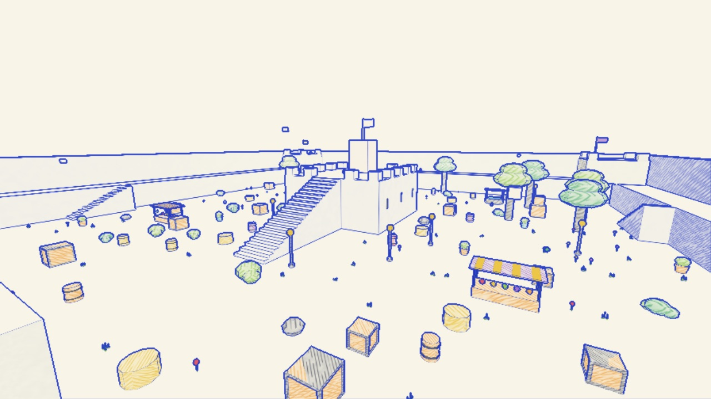
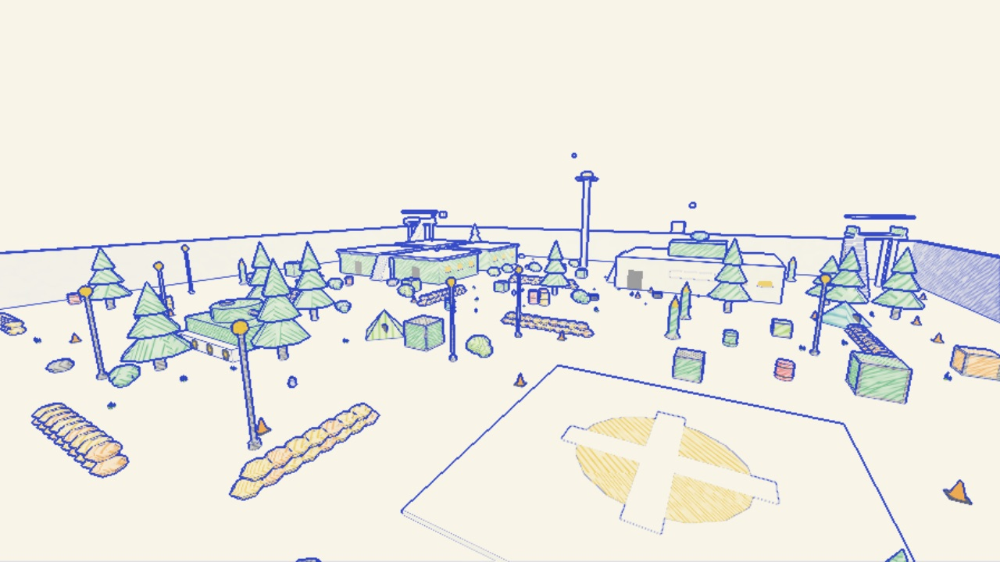

# doodleshooter-port

An unofficial native port of [Doodle District](https://doodleshooter.vercel.app/) for Android and iOS, built with Godot 4.6.3 and GDScript. The name combines **port** and **portable**. Reproduce the original game first; create new maps afterward.

The project provides offline survival, offline free-for-all with bots, built-in LAN hosting, and an experimental online lobby mode. **It is not yet a complete clone**: reference comparison, complete multiplayer validation, and device verification remain unfinished. See [docs/PARITY.md](docs/PARITY.md) for the full status.

All port UI and project documentation are in English. The original game's attribution appears in the game and in [CREDITS.md](CREDITS.md). The historical upstream source snapshot is preserved unchanged for provenance and contains its own localized strings; it is not shipped in the native application.

## Maps

Doodle District, Doodle Jungle, and Doodle Mexico come from the original game. Jungle comes from the deployed web version archived separately on November 19, 2026. The other seven are port additions and are not part of the original. All are shown in the port's coloured-pencil shading; the original hatching is available in Settings.

| | | |
| --- | --- | --- |
|  Doodle District (original) |  Doodle Mexico (original) |  Doodle Castle (port) |
|  Doodle Harbor (port) |  Doodle Pyramid (port) |  Doodle Station (port) |
|  Doodle Forest (port) |  Doodle School (port) |  Doodle Base (port) |
|  Doodle Jungle (original) | | |

Regenerate them with `make screenshots` (desktop renders, converted with macOS `sips`).

## Run

Install standard Godot 4.6.3. Open `native/project.godot` and press Run, or use the Makefile from the repository root.

```sh
make run
```

To display touch controls on desktop:

```sh
make touch
```

Touch controls appear automatically on mobile. Menus accept touch through mouse emulation; gameplay uses separate multitouch input. The right-thumb cluster has fire, jump, slide/dash, aim (tap to latch), grapple, quick slash, and grenade. Several actions are merged, as in large mobile shooters: pushing the joystick fully forward sprints, and dragging on up to the RUN marker keeps you running with the thumb lifted; one button slides on the ground and dashes in the air; empty magazines reload by themselves and tapping the active weapon chip reloads early, while tapping another chip switches weapon; dragging any finger that is not on the joystick turns the camera, including the one holding fire. Arena modes add a scoreboard button. **Controls & settings → Customize touch layout** lets you drag, resize, and fade every control; the layout is saved on the device. **Touch & aiming** in the same menu makes each of these behaviours optional and adds look and aiming sensitivity, inverted vertical look, gyroscope aiming (off, while aiming, or always), auto fire on target, hold-to-aim, a second fire button on the left, a reload button, and a fixed joystick. Online mode requires the separate lobby server described below; offline and LAN modes do not.

Run `make help` for all targets. Set `GODOT_BIN`, `PYTHON`, `ADB`, `NODE`, or `NPM` on the command line to use a specific executable.

## Android

The current development APK is stored at `builds/android/doodleshooter-port-debug.apk`. Application ID: `com.doodleshooter.port`. It includes ARM64 and x86_64 binaries and uses a debug signing key. It has not been published to Google Play. The current source was exported and its APK signature and bundled resources were verified on November 10, 2026; device play remains unverified.

To rebuild, install the Godot 4.6.3 export templates and configure Java 17, the Android SDK, and a debug keystore in the editor settings:

```sh
make android
```

`make build` also exports the debug APK. Use `make install-android` to install that APK on an ADB-connected device. `make android-release` exports a separate release APK after release signing is configured. AAB exports require a Gradle build.

## Offline play

Port additions (not in the original game): seven extra maps chosen from animated preview cards, the SMG and bazooka, smoke grenades (H) that blur the view of anyone inside the cloud, a woozy view at low health (the sway can be switched off in Settings), Easy/Normal/Hard and wave-size choices for survival, a graphics detail setting, a coloured-pencil shading style (Settings → Shading switches back to the original hatching), and a frame rate counter. The revolver is taken from the original source.

Choose **Play offline** from the main menu:

- **Survival**: fight growing enemy waves and bosses, with saved checkpoints.
- **Free for all with bots**: select 1–9 bots and Easy, Normal, or Hard difficulty, then start an arena match. Bots fight you and each other. First to 20 kills wins; otherwise the highest score wins after 10 minutes. Reappearing players and bots receive two seconds of protection. Respawns are automatic, and pausing stops the offline match.

Both modes work without Internet access or a server. The bot mode is a port feature, not a claim that the original game provides the same AI mode.

## Local network (LAN)

1. Connect the devices to the same Wi-Fi network or hotspot.
2. On one device, choose **Local network · LAN → Host LAN game**. Its lobby displays available local IPv4 addresses.
3. On the others, enter the host's IP in **Join LAN game**. The default port is TCP 8912; an explicit `address:port` is also accepted.
4. The host chooses the map and starts the match. Up to ten people can join, including late joiners. LAN uses the same 20-kill/10-minute rules as online matches.

The server runs inside the hosting game. No Internet, account, or Python installation is needed. Keep the host device in the game; closing its room ends the connection for guests. Guest Wi-Fi isolation or local firewalls can prevent connections. Current LAN rooms contain human players; bots are available in offline matches. LAN room discovery and LAN host migration are not implemented.

Headless tests exercise two actual Godot game processes through arena loading, remote avatars, damage, scoring, and respawning. Connections between physical devices still need verification.

## Credits

**Credits** on the main menu contains original-game attribution, source provenance, music/effect credits, engine/font credits, full bundled notices, the font license, and Godot's license. It includes links to the original game and reference repository.

## Experimental online play

Run the native lobby server with Python 3.11 or later:

```sh
make server-deps
make server
```

The server binds to `127.0.0.1:8911` by default. To expose this separate online server to other devices, set `DOODLE_BIND=0.0.0.0` when starting it. The built-in LAN menu does not need this server. In **Play online**, enter a WebSocket URL reachable from the client: `ws://127.0.0.1:8911` on the same desktop, `ws://10.0.2.2:8911` from the Android emulator, or the server computer's LAN address from a phone. There is no hosted matchmaking service or web-lobby interoperability.

The implementation includes public/private lobbies, codes, quick play, ten-player rooms, late joining, a 20-kill/10-minute limit, respawning, and host migration. Server protocol tests pass; a complete match between Godot clients has not been verified. The server caps reported damage but trusts client hit reports and movement.

### How the original connects, and the planned native version

The original game has no game server of its own. It uses the public PeerJS signalling service (`0.peerjs.com`) only to introduce players, then connects them directly over WebRTC data channels; the host player's device is the authority. Lobby codes are PeerJS ids, and quick play knocks on sixteen well-known public slots (`PUB0`–`PUB15`).

The port plans the same approach: first a port-only mode with its own id prefix, then a separate cross-play mode that joins the original's web lobbies with only its maps and weapons. **Not implemented yet.** It needs the official Godot WebRTC extension (`godotengine/webrtc-native`, MIT) bundled in the app, which is waiting for approval.

**Known limitation, shared with the original:** connections use public STUN servers only (Google and Cloudflare), with no TURN relay. When both players sit behind strict NAT, such as some mobile carrier networks or corporate Wi-Fi, they may fail to connect at all. Switching one player to a different network usually helps. Adding a TURN relay would fix it but needs a paid or self-hosted service.

## iOS

**Deferred at the user's request.** The `iOS` preset uses the same scene and controls, with bundle identifier `com.doodleshooter.port`.

When resuming iOS work, install Xcode and the Godot export templates on macOS. Set your Apple Team ID in `native/export_presets.cfg` or Project → Export → iOS:

```sh
make ios
```

The initial export attempt stopped because `App Store Team ID` was missing. No iOS build has been produced or tested.

## Verification

```sh
make check
make test-server
```

The Godot check verifies reference hashes, imports the project, rejects engine/script errors, and runs headless gameplay, bot-match, menu-routing, native LAN protocol, and two-process LAN game checks. Coverage includes weapons, parries, grappling, multitouch, enemy hitboxes, boss projectile emission, bot-versus-bot fire, player melee damage, respawns, and the bot match kill limit. Run `make server-deps` before `make test-server` to install the dependencies for the WebSocket lobby tests.

Desktop and Android-emulator still frames of the menus, HUD, and touch layout have been captured and inspected. Physical-device play, physical touch, and gameplay visual parity against the original remain unverified. See [docs/VALIDATION.md](docs/VALIDATION.md).

To capture the four menu screens with a graphical desktop session:

```sh
make capture-menus
```

Screenshots are written to `builds/validation/`; set `DOODLE_CAPTURE_DIR` to choose another location.

## Reference and layout

- `native/`: shared native project and gameplay code.
- `reference/upstream/`: unmodified web source snapshot.
- `reference/manifest.json`: source repository, revision, and original file hashes.
- `tools/extract-reference.mjs`: deterministic geometry, model, hitbox, and parameter conversion.
- `tools/extract-audio.mjs`: offline rendering of the original soundtrack and effects.
- `server/` and `tests/`: native lobby server and protocol tests.
- `docs/PARITY.md`: specific differences from the original game.

To regenerate native data without downloading dependencies:

```sh
make assets-reference
```

The converter executes the reference's procedural generators with its local Three.js dependency, reverses triangle winding for Godot, and preserves coordinates. Bot matches, LAN matches, and online matches load the converted arena variants. Extracted display names are normalized to English.

To render the original audio again, install Node.js, ffmpeg, and the build-only dependencies:

```sh
make audio-deps
make assets-audio
```

The renderer reuses existing music files; remove the relevant generated OGG files before regenerating a changed composition. The reference snapshot remains unchanged.
