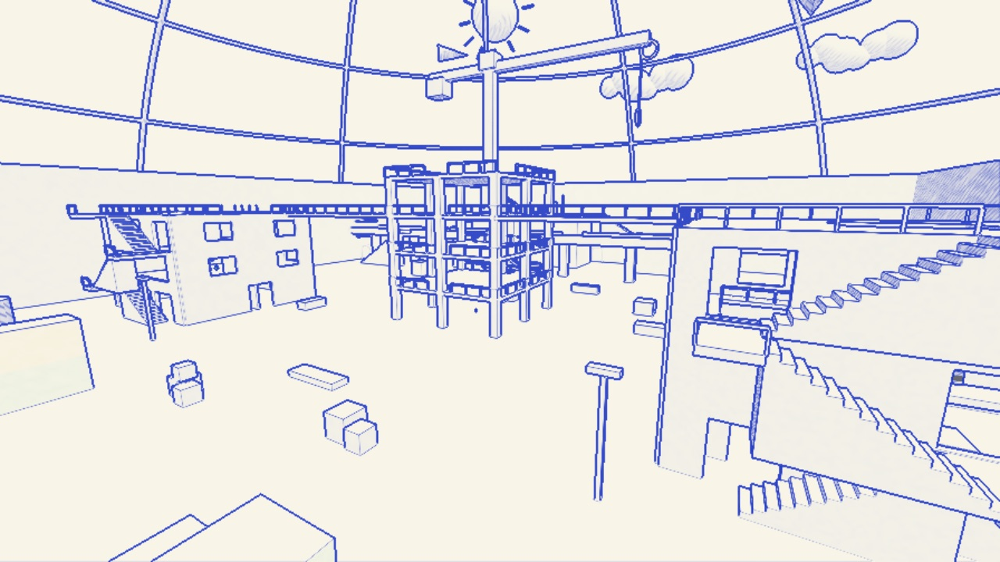
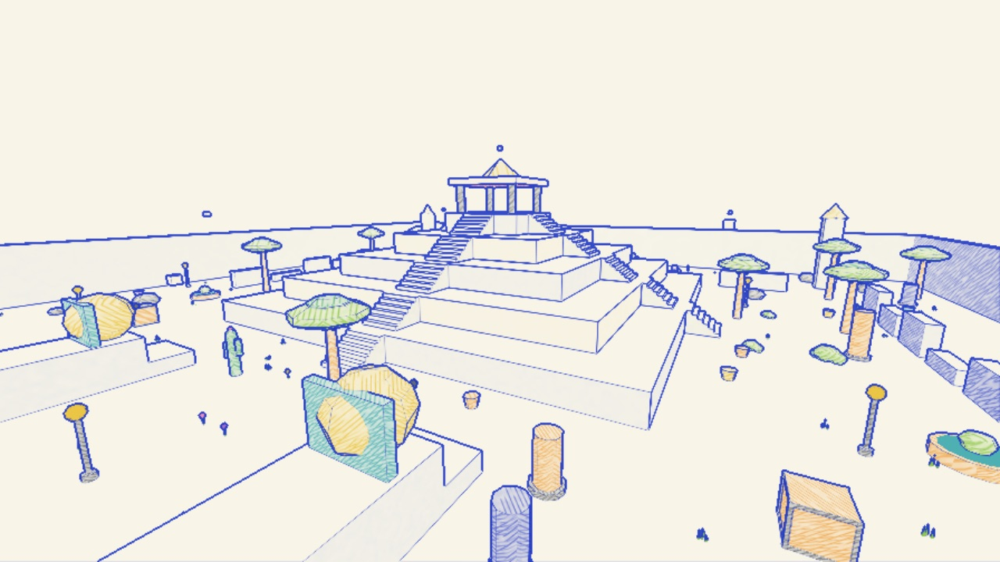

<div align="center">
  
  <h1>doodleshooter-port</h1>
  <p>An unofficial native port of <a href="https://doodleshooter.vercel.app/">Doodle District</a> for Mobile and Desktop.</p>
</div>

The name combines **port** and **portable**. *Reproduce the original game first; create new maps afterward.*

The project provides **offline survival**, **offline free-for-all with bots**, **built-in LAN hosting**, and an **experimental online lobby mode**. **It is not yet a complete clone**: reference comparison, complete multiplayer validation, and device verification remain unfinished. See [docs/PARITY.md](docs/PARITY.md) for the full status.

All port UI and project documentation are in English. Original-game attribution appears in the game and in [CREDITS.md](CREDITS.md). The historical upstream source snapshot is preserved unchanged for provenance and contains its own localized strings; it is *not* shipped in the native application.

## 📑 Contents

- [🗺️ Maps](#-maps)
- [🚀 Run](#-run)
- [🕹️ Controls](#-controls)
- [🤖 Android](#-android)
- [🎮 Offline play](#-offline-play)
- [📡 Local network (LAN)](#-local-network-lan)
- [🙌 Credits](#-credits)
- [🌐 Experimental online play](#-experimental-online-play)
- [🍎 iOS](#-ios)
- [💻 Desktop (Windows, Linux, macOS)](#-desktop-windows-linux-macos)
- [✅ Verification](#-verification)
- [🛠️ Tech stack](#-tech-stack)
- [📁 Reference and layout](#-reference-and-layout)

## 🗺️ Maps

**Doodle District**, **Doodle Jungle**, and **Doodle Mexico** come from the original game (*Jungle* comes from the deployed web version archived separately on November 19, 2026). The other seven are **port additions** and are *not* part of the original. All are shown in the port's coloured-pencil shading; the original hatching is available in **Settings**.

| | | |
| --- | --- | --- |
|  **Doodle District** *(original)* |  **Doodle Jungle** *(original)* |  **Doodle Mexico** *(original)* |
|  **Doodle Castle** *(port)* |  **Doodle Harbor** *(port)* |  **Doodle Pyramid** *(port)* |
|  **Doodle Station** *(port)* |  **Doodle Forest** *(port)* |  **Doodle School** *(port)* |
|  **Doodle Base** *(port)* | | |

Regenerate screenshots with `make screenshots` (*desktop renders, converted with macOS `sips`*).

## 🚀 Run

Install standard **Godot 4.6.3**. Open `native/project.godot` and press **Run**, or use the `Makefile` from the repository root:

```sh
make run
```

To display touch controls on desktop:

```sh
make touch
```

- **Offline** and **LAN** modes work out of the box with no extra server; **Online** mode requires the separate lobby server described below.
- Run `make help` for all targets. Override executables on the command line with `GODOT_BIN`, `PYTHON`, `ADB`, `NODE`, or `NPM`.

## 🕹️ Controls

### ⌨️ Mouse + keyboard & 🎮 Controller

| Action | Mouse + Keyboard | PlayStation / Xbox Controller |
| --- | --- | --- |
| Move | `W` `A` `S` `D` | Left Stick |
| Look | Mouse | Right Stick · Gyroscope *(DualShock / DualSense on macOS & iOS, or mobile IMU; uses Look / Aim / Gyro settings)* |
| Sprint | `Shift` *(hold)* | `L3` / `LS` *(toggle while moving forward)* |
| Fire / Slash | `LMB` | `R2` / `RT` |
| Aim / Block | `RMB` | `L2` / `LT` |
| Charged katana execution *(survival)* | `LMB` + `RMB` | `L2` + `R2` / `LT` + `RT` |
| Jump / Wall jump / Double jump | `Space` | `×` / `A` |
| Slide *(ground)* / Air dash *(air)* | `C` | `○` / `B` |
| Grapple *(tap swing, hold reel, press again to release)* | `Q` (`Space` to launch) | `L1` / `LB` (`×` / `A` to launch) |
| Quick katana slash | `F` | `R1` / `RB` |
| Reload | `R` | `□` / `X` |
| Switch weapons | `1`–`7` / Mouse Wheel Up & Down | `△` / `Y` *(next)* · `D-pad Up / Down` *(prev / next)* · `Touchpad swipe` *(7-weapon radial wheel, port)* |
| Grenade *(hold to throw further)* | `G` | `R3` / `RS` or `D-pad Left` |
| Smoke grenade *(port)* | `H` | `D-pad Right` |
| Scoreboard *(bot / network matches)* | `Tab` | `Touchpad click` or `Create` / `View` |
| Pause | `Esc` | `Options` / `Menu` |
| Menu navigate / Select / Back | Arrows · `Enter` · `Esc` | D-pad / Left Stick · `×` / `A` · `○` / `B` |

### 📱 Touch & gyroscope

Touch controls appear automatically on mobile — hiding seamlessly while a controller is used and reappearing as soon as you touch the screen (*menus use mouse emulation; gameplay uses dedicated multitouch input*):

- **Movement & sprint**: push the left joystick fully forward to sprint; drag up to the `RUN` marker to auto-run with your thumb lifted.
- **Camera**: drag anywhere outside the joystick to turn the camera — *including while holding fire*.
- **Right-thumb cluster**: fire, jump, `SLIDE` / `DASH` (*slides on the ground, dashes in the air*), aim (*tap to latch*), grapple, quick slash, and grenade. Arena modes also add a **scoreboard** button.
- **Weapons & reload**: empty magazines reload automatically; tap the active weapon chip to reload early, or tap another chip to switch weapons.
- **Custom layout**: open **Controls & settings → Customize touch layout** to drag, resize, and adjust opacity for every button (*saved locally on the device*).
- **Touch & aiming / Controller options**: configure look/aim sensitivity, inverted vertical look, **gyroscope aiming** (*off*, *while aiming*, or *always* — works for mobile sensors and DualShock / DualSense controllers even with touch controls hidden), **controller vibration** (*rumble*), **controller LED light bar** (*DualShock / DualSense reactive ink colours, port addition*), auto-fire on target, hold-to-aim, a second left-side fire button, a dedicated reload button, and a fixed joystick.

## 🤖 Android

- **Application ID**: `com.doodleshooter.port`
- **ABIs**: `ARM64` and `x86_64` (`Android` preset in `native/export_presets.cfg`).
- **Status**: APK signature and bundled resources were verified on November 10, 2026; *physical-device play remains unverified*. Not published to Google Play.

**Prerequisites**: the **Godot 4.6.3** export templates, plus **Java 17**, the **Android SDK**, and a debug keystore set in Godot's **Editor Settings → Export → Android**.

| Command | Output |
|---|---|
| `make android` (or `make build`) | debug APK `builds/android/doodleshooter-port-v<version>-<versionCode>-debug.apk` |
| `make android-release` | release APK `builds/android/doodleshooter-port-v<version>-<versionCode>-release.apk`, signed with `keys/release.properties` |
| `make install-android` | installs the current debug APK on an `adb`-connected device |

For example, version `2.0.1` with version code `1` gives `doodleshooter-port-v2.0.1-1-debug.apk`. The debug APK uses the `Android` preset (`ARM64` and `x86_64`); the release APK uses the `Android Release (arm64)` preset (`ARM64` only), exported unsigned and signed afterwards. `bump_version.py` keeps both presets' versions in step. `AAB` exports require a Gradle build and are not set up.

Run one Godot export at a time, also across projects: parallel exports share Godot's temporary APK in its global cache and fail with "Could not unzip temporary unaligned APK" or produce a broken APK.

### Version and version code

The version comes from `config/version` in `native/project.godot` and the version code from `version/code` in `native/export_presets.cfg`. `tools/bump_version.py` reads both (`--version`, `--code`, `--show`) and the `Makefile` names the APKs from them, so never edit the file names by hand:

```sh
make version      # version=X.Y.Z version_code=N
make bump-patch   # or bump-minor / bump-major: new version, version code + 1
```

### Release signing

`make android-release` exports the unsigned `Android Release (arm64)` preset and then runs `tools/sign_apk.py`, which aligns it with `zipalign` (16 KB pages on build-tools 35+) and signs it with `apksigner` using `keys/release.properties` (git-ignored; copy `keys/release.properties.example`):

```properties
storeFile=release.jks
storePassword=...
keyAlias=key0
keyPassword=...
```

- `storeFile` is relative to `keys/`.
- The file follows Java Properties rules: a literal backslash is written `\\`; other characters (`= : # ! $`, quotes) go as they are, without quotes.
- The passwords reach `apksigner` through environment variables and are never printed.

Godot is not left to sign the release itself because it passes the keystore password through a shell: a password with shell characters (such as `$`, `!`, `|`, `\`, `"`, `` ` ``, `&`, `<`, `>`) makes its export fail with a shell syntax error or "Release Username and/or Password is invalid". The script needs Python 3 and the Android SDK build-tools (found through `ANDROID_HOME`, `ANDROID_SDK_ROOT` or `~/Library/Android/sdk`). Never commit keystores or passwords.

## 🎮 Offline play

> **Port additions** *(not in the original game)*: seven extra maps with animated preview cards, the **SMG** and **bazooka**, **smoke grenades** (`H`) that blur anyone inside the cloud, a **woozy low-health view** (*toggleable in Settings*), **Easy / Normal / Hard / Insane** and wave-size choices for survival, a **graphics detail** setting, a **coloured-pencil shading** style (**Settings → Shading** switches back to the original hatching), **accessibility & visual comfort options** (**Settings → Accessibility**: **Paper brightness** defaulting to `95%` and going down to dark chalkboard mode, **Edge shadow** vignette defaulting to `5%`, paper themes, colorblind-safe inks, screen-shake/damage-flash sliders, high-contrast crosshair, and bold 3D outlines), and an **FPS counter**. *The revolver comes from the original source.*

Choose **Play offline** from the main menu:

- 🛡️ **Survival**: fight growing enemy waves and bosses, with saved checkpoints.
- 🤖 **Free for all with bots**: choose `1–9` bots and **Easy**, **Normal**, or **Hard** difficulty. Bots fight you and each other. First to **20 kills** wins; otherwise the highest score wins after **10 minutes**. Respawns are automatic with 2 seconds of spawn protection, and pausing stops the match.

Both modes work without Internet access or a server. *The bot mode is a port feature, not a claim that the original game provides the same AI mode.*

## 📡 Local network (LAN)

1. Connect all devices to the same **Wi-Fi network** or **hotspot**.
2. On the host device, open **Local network · LAN → Host LAN game** (*the lobby displays available local IPv4 addresses*).
3. On guest devices, enter the host's IP in **Join LAN game**. Default port: `TCP 8912` (*explicit `address:port` is also accepted*).
4. The host selects the map and starts the match. Up to **10 players** can join, including late joiners, using the same **20-kill / 10-minute** rules as online matches.

- **Built-in server**: runs inside the hosting game — *no Internet, account, or Python installation required*. Keep the host in the game; closing the room disconnects guests.
- **Current notes**: guest Wi-Fi isolation or local firewalls can block connections. LAN rooms currently support human players only (*bots are offline-only*). LAN room discovery and host migration are not implemented.
- **Testing**: headless tests exercise two actual Godot game processes through arena loading, remote avatars, damage, scoring, and respawning; *physical-device LAN play still needs verification*.

## 🙌 Credits

**Credits** on the main menu contains original-game attribution, source provenance, music/effect credits, engine/font credits, full bundled notices, the font license, and Godot's license, along with links to the original game and reference repository.

## 🌐 Experimental online play

Run the native lobby server with **Python 3.11+**:

```sh
make server-deps
make server
```

- **Default bind**: `127.0.0.1:8911`. Set `DOODLE_BIND=0.0.0.0` to expose it to other devices on your network (*the built-in LAN menu does not need this server*).
- **Client URLs** (in **Play online**):
  - Same desktop: `ws://127.0.0.1:8911`
  - Android emulator: `ws://10.0.2.2:8911`
  - Phone on LAN: `ws://<server-lan-ip>:8911`
- **Features & status**: public/private lobbies, room codes, quick play, 10-player rooms, late joining, 20-kill / 10-minute matches, respawning, and host migration. Server protocol tests pass; *a full match between Godot clients has not been verified*. There is no hosted matchmaking service or web-lobby interoperability. The server caps reported damage but trusts client hit reports and movement.

### 🔗 How the original connects, and the planned native version

The original game has no game server of its own. It uses the public **PeerJS** signalling service (`0.peerjs.com`) only to introduce players, then connects them directly over **WebRTC** data channels where the host player's device is the authority. Lobby codes are PeerJS IDs, and quick play checks sixteen public slots (`PUB0`–`PUB15`).

The port plans the same approach: first a port-only mode with its own ID prefix, then a separate cross-play mode joining the original's web lobbies with only its maps and weapons. **Not implemented yet** — it requires bundling the official Godot WebRTC extension (`godotengine/webrtc-native`, MIT), which is waiting for approval.

> **Known limitation** *(shared with the original)*: connections use public **STUN** servers only (Google and Cloudflare) with no **TURN** relay. Players behind strict NAT (*some mobile carriers or corporate Wi-Fi*) may fail to connect; switching one player to another network usually helps.

## 🍎 iOS

- **Bundle identifier**: `com.doodleshooter.port` (`iOS` preset).
- **Prerequisites**: Xcode signed in to your Apple ID and the Godot 4.6.3 export templates.

`make ipa` writes `builds/ios/doodleshooter-port-v<version>-<build>-release.ipa`, signed through Xcode:

1. Godot exports the iOS preset as an Xcode project (release template).
2. `xcodebuild` archives it in Release and exports the IPA with automatic signing.

- **Team:** `DEVELOPMENT_TEAM` in `keys/ios.properties` (git-ignored; copy `keys/ios.properties.example`), or `TEAM=<id>`. `tools/export_ipa.sh` writes it into the iOS preset only for the export, together with `application/export_project_only=true`, and always restores `native/export_presets.cfg` afterwards, so the team id never reaches git.
- **Version:** `application/short_version` and `application/version` in the `iOS` preset, kept in step with Android by `make bump-patch|minor|major`.
- **Export method:** `IPA_METHOD=debugging` (default with a free personal team), `release-testing` (Ad Hoc) or `app-store-connect` (default with a paid team). A free personal team only allows `debugging`: the IPA installs on your own registered devices and stops opening after 7 days. Ad Hoc, TestFlight and the App Store need the paid Apple Developer Program.

`make ios` still writes the plain Xcode project to `builds/ios/doodleshooter-port-v<version>.zip`.

## 💻 Desktop (Windows, Linux, macOS)

The shared project in `native/` runs on desktop with mouse + keyboard or controllers (`use_touch` defaults to off outside mobile), and includes a **Fullscreen** toggle in **Settings** (`video/fullscreen`). `native/project.godot` enables `import_s3tc_bptc` alongside `import_etc2_astc` for desktop VRAM texture compression.

`native/export_presets.cfg` defines three desktop presets (*requires Godot 4.6.3 export templates*):

- 🪟 **Windows Desktop** (`x86_64`, embedded PCK) → `builds/windows/doodleshooter-port-v<version>-<code>-release.exe` (`make windows`)
- 🐧 **Linux** (`x86_64`, embedded PCK) → `builds/linux/doodleshooter-port-v<version>.x86_64` (`make linux`)
- 🍏 **macOS** (`universal`, bundle ID `com.doodleshooter.port`, ad-hoc signed / `codesign=1`) → `builds/macos/doodleshooter-port-v<version>-<code>-release.dmg` (`make dmg`), or the plain `builds/macos/doodleshooter-port-v<version>.zip` (`make macos`)

`make bump-patch|minor|major` writes the version code as the macOS build number (`application/version`) and as the fourth number of the Windows `file_version`/`product_version` (`2.0.2.2`).

**First launch on another Mac (Gatekeeper).** The app is ad-hoc signed but not notarized, so macOS blocks a copy that was downloaded (web, AirDrop, chat apps) with "cannot verify the developer". To open it:

- **macOS 15 Sequoia or later:** try to open it once, then System Settings → Privacy & Security → **Open Anyway**. Right-click → Open no longer bypasses the check.
- **macOS 14 or earlier:** right-click the app → **Open**, then confirm.
- **Any version, from Terminal:** `xattr -dr com.apple.quarantine "/Applications/doodleshooter-port.app"`

The Mac that built it opens it directly. Only a Developer ID certificate plus Apple notarization (paid Apple Developer Program) removes the warning. The disk image has no Applications shortcut: drag the app to Applications, or run it from the image.

## ✅ Verification

```sh
make check
make test-server
```

- `make check` verifies reference hashes, imports the project, rejects engine/script errors, and runs headless gameplay, bot-match, menu-routing, native LAN protocol, and two-process LAN checks (*covering weapons, parries, grappling, multitouch, enemy hitboxes, boss projectiles, bot-vs-bot fire, melee, respawns, and kill limits*).
- Run `make server-deps` before `make test-server` to install WebSocket lobby test dependencies.
- Desktop and Android-emulator still frames of the menus, HUD, and touch layout have been captured and inspected. *Physical-device play, physical touch, and gameplay visual parity against the original remain unverified.* See [docs/VALIDATION.md](docs/VALIDATION.md).

To capture the four menu screens in a graphical desktop session:

```sh
make capture-menus
```

Screenshots are written to `builds/validation/` (*override with `DOODLE_CAPTURE_DIR`*).

## 🛠️ Tech stack

- **Engine & language**: **Godot 4.6.3** (`GL Compatibility` renderer) & **GDScript**
- **Targets**: **Android** (`ARM64` / `x86_64`), **iOS** (*deferred*), **Windows**, **Linux**, and **macOS**
- **Online lobby server**: **Python 3.11+** (`websockets`)
- **Asset conversion & audio rendering**: **Node.js**, local **Three.js** reference generators, `ffmpeg`, and `Makefile` scripts

## 📁 Reference and layout

- `native/`: shared native project and gameplay code.
- `reference/upstream/`: unmodified web source snapshot.
- `reference/manifest.json`: source repository, revision, and original file hashes.
- `tools/extract-reference.mjs`: deterministic geometry, model, hitbox, and parameter conversion.
- `tools/extract-audio.mjs`: offline rendering of the original soundtrack and effects.
- `server/` and `tests/`: native lobby server and protocol tests.
- `docs/PARITY.md`: specific differences from the original game.

To regenerate native data without downloading dependencies:

```sh
make assets-reference
```

The converter executes the reference's procedural generators with its local Three.js dependency, reverses triangle winding for Godot, and preserves coordinates. Bot, LAN, and online matches load the converted arena variants, with extracted display names normalized to English.

To render the original audio again, install **Node.js**, `ffmpeg`, and the build-only dependencies:

```sh
make audio-deps
make assets-audio
```

*The renderer reuses existing music files; remove the relevant generated `.ogg` files before regenerating a changed composition. The reference snapshot remains unchanged.*
